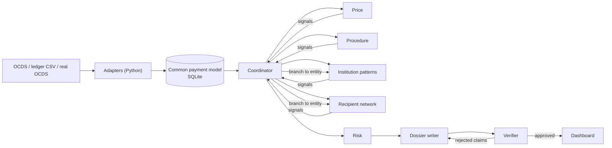

# Inquest

**A team of AI agents that simultaneously monitors how public money is being spent, regardless of its source:** public procurement by ministries and municipalities, payments from municipal budgets, or school funds and the budget of an individual school.

The agents look for signals that money is being spent in ways that do not make financial sense or is flowing in unusual patterns:

- overpriced goods compared to similar institutions or the market,
- the same recipient repeatedly receiving payments,
- payments deliberately split into smaller amounts to stay below approval thresholds,
- expenses with no clear purpose,
- sudden spikes in spending towards the end of the year.

When one agent finds a suspicious recipient or institution, the others widen the investigation to that entity's other payments. Each flagged case ends in a plain-language dossier that a Verifier agent has checked against the source records.

> **Inquest reports risk, never guilt.** It shows *where it is worth looking, and why*. A person decides.

Built by **team Wision** for the JigJoy Hackathon 2026 ("AI agents in finance", risk & compliance) on [Mozaik](https://github.com/jigjoy-ai/mozaik), JigJoy's TypeScript runtime for concurrent agents.

---

## 1. Install

Requirements: **Node 20+** and **Python 3.10+** (standard library only).

```bash
git clone https://github.com/vuk-djordjevic/inquest.git
cd inquest
npm install
npm install --prefix dashboard
```

## 2. Choose your data

Everything is loaded into one SQLite database, `data/inquest.db`, by `npm run data`. Rerun it whenever you add or change data.

### a) Test data (default, no download)

```bash
npm run data
```

This generates 7,578 fictional payments (procurement of 10 municipalities and ministries, ledgers of 48 schools, health centers, utilities and local communities, over 2 years). It also injects **21 known test cases** and clean controls, so you can measure what the agents find. All names are fictional.

### b) Real Serbian public procurement

```bash
python data/prep/fetch_real.py          # 2021, about 64,000 contracts (~22 MB)
npm run data                            # loads test data + real data
```

Other ranges: `python data/prep/fetch_real.py 2020 2022` or `full` (July 2020 to May 2022).

Source: [Serbia: OpenTender](https://data.open-contracting.org/en/publication/139) from the OCP Data Registry, compiled by the Government Transparency Institute from the national Public Procurement Portal. License CC BY-NC-SA 4.0.

The real data has buyers and suppliers (with national IDs), contract values, procedure types, number of bids, tender dates and CPV codes. It has **no item quantities**, so unit-price comparison does not run on it; the procedure, pattern and network signals do.

### c) Your own procurement data

Any [OCDS](https://standard.open-contracting.org/) file (`.json`, `.jsonl`, optionally `.gz`) placed in `data/raw/real/` is loaded by `npm run data` and marked as real data. Most national portals publish OCDS; see the [OCP Data Registry](https://data.open-contracting.org/).

## 3. Offline or with real AI agents

Without any keys, everything runs **offline**: the agents use deterministic rules and templates instead of an LLM. This is free and good for trying things out.

To run real LLM agents, create `.env`:

```bash
cp .env.example .env
```

and set at least:

```ini
ANTHROPIC_API_KEY=sk-ant-...
INQUEST_MODEL_FAST=claude-haiku-4-5
INQUEST_MODEL_SMART=claude-haiku-4-5    # cheapest; use a larger model for better dossiers
INQUEST_LLM_MAX_CALLS=300               # hard cap on LLM calls per run
TAVILY_API_KEY=tvly-...                 # optional: live web search for market prices
```

Without a search key, the Price agent replays the recorded search cache. To force offline mode even with a key, set `INQUEST_LLM_MODE=offline`.

Rough cost with Haiku: the test data run is a few cents; all 64,000 real 2021 contracts need about 1,600 LLM calls, about $2 (set `INQUEST_LLM_MAX_CALLS=2000`). The agents call the LLM only for cases that could still cross the flag threshold.

## 4. Run

### Dashboard (recommended)

```bash
npm run dashboard:build
npm run serve            # open http://localhost:8787
```

In the toolbar choose the scope and press **Run agent team**:

| Scope | What runs | Time offline |
|---|---|---|
| Demo institutions | 7 institutions with the most interesting test cases | seconds |
| All test data | all 7,578 test payments, with evaluation | ~15 s |
| Real procurement data, sample | the first 5,000 real contracts (recommended with an LLM: ~40 s, ~$0.03 with Haiku) | ~10 s |
| Real procurement data | all loaded real contracts | ~2 min for 64,000 |

Real cases are shown only **in aggregate** (counts per signal), never by company name. To list them by name for local review, set `INQUEST_SHOW_REAL_CASES=1` in `.env`.

For dashboard development: `npm run serve` plus `npm run dashboard:dev` (Vite on :5173, proxies `/api`).

### Command line

```bash
npm run investigate                                  # all test data + evaluation
npm run investigate -- --payers MU03,MU07,SC03       # only these institutions
npm run investigate -- --dataset real                # only real data
npm run investigate -- --dataset real --limit 5000   # a quick sample of real data
npm run compare                                      # agent team vs. one sequential agent
npm test
```

### Recommended: real data with real agents, first 5,000 contracts

The full real dataset with an LLM takes a while, so start with a sample. Set `INQUEST_LLM_MODE=auto` in `.env` (with `ANTHROPIC_API_KEY` set), then:

```bash
npm run investigate -- --dataset real --limit 5000
```

or choose **Real procurement data, sample** in the dashboard.

With Haiku this took about 40 s, 26 LLM calls and about $0.03; 6 contracts were flagged. The first 5,000 contracts cover only the start of 2021, so mostly procedure signals (single bid, short tender) fire. When that works, run without `--limit` (about 1,600 LLM calls, ~$2, set `INQUEST_LLM_MAX_CALLS=2000`).

### Live view of the agents (optional)

To watch every agent's loop in Mozaik Cloud, pair once:

```bash
node node_modules/@mozaik-ai/core/node_modules/@mozaik-ai/cloud-sdk/src/bin.mjs pair
```

The run then prints a "mozaik cloud — watching live" link. Note that prompts, including real data, are sent to the cloud.

---

## How it works (in short)



- **Adapters** convert each source format into one common payment model, so the agents never see source formats.
- All agents are participants in one **Mozaik runtime** and talk only through events. The four signal agents check the same payment at the same time.
- When a case is strong enough, the Coordinator opens a **branch investigation** of the recipient or institution. When two lines of investigation meet, it **merges** the cases.
- The **Risk** agent combines signals into a score. The **Dossier writer** writes a report that may only cite numbered facts. The **Verifier** recomputes every fact from the source records and rejects wrong claims; the writer then writes a new draft (shown as Draft 1, Draft 2… in the dashboard).
- Shared state (the case board) lives in SQLite.

| Agent | Job |
|---|---|
| Coordinator | queues payments, owns the case board, opens branches, merges cases |
| Price | compares unit prices with similar institutions and with live market prices from the web |
| Procurement procedure | single bid, short tender period, identical or suspiciously close bids, value raised by amendments |
| Institution patterns | splitting below thresholds, year-end spikes, repeated works, over-plan spending, vague purpose |
| Recipient network | newly founded or unusual recipients, supplier concentration |
| Risk assessment | combines signals, looks for a legitimate explanation |
| Dossier writer | plain-language dossier with links to every source record |
| Verifier | checks every number and every market price before a dossier is approved |

Signals and their thresholds: [src/domain/signal-catalog.ts](src/domain/signal-catalog.ts) and [data/reference/categories.json](data/reference/categories.json). Thresholds are assumptions and should be tuned to local law; for real Serbian data a single bid alone never flags a case (about 62% of open procedures have one bid), and the minimum tender period is 9 days.

## Results on the test data

| | Agent team | Single agent |
|---|---:|---:|
| Injected cases found | 21/21 | 21/21 |
| False alarms on 67 clean payments | 0 | 0 |
| Wall time (offline) | 9.1 s | 35.0 s |
| Merged lines of investigation | 23 | 10 |

On real 2021 procurement (offline), 2.1% of contracts are flagged. Test results show that the pipeline works end to end; they do not measure accuracy on real spending.

## Ethics and limits

- The vocabulary is "risk signal", "unusual", "worth checking". Words like *corruption* or *fraud* are never used about an entity; the Verifier enforces this.
- Every dossier lists its signals, rules, facts and links to the source records.
- Real data is shown only in aggregate by default.
- Price comparison works only where the unit is clear; registry lookups use a fictional register; procurements exempt from the law are often not published.

## Project layout

```
data/prep/        Python: data generators, adapters (OCDS, ledgers), loader, fetch_real.py
data/reference/   categories, units, thresholds
data/raw/         raw sources; real/ for real OCDS files
src/agents/       Mozaik agents
src/signals/      signal rules
src/tools/        web search, page fetch, business register, DB queries
src/server/       HTTP API + live event stream
dashboard/        React dashboard
test/             tests
```
