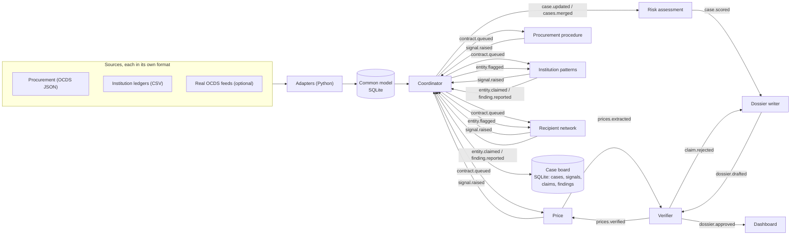

# Inquest

**A team of concurrent AI agents that screens how public money is spent** (public procurement of municipalities and ministries, municipal payments, the budget of a single school) and produces a ranked list of risky expenses, each with a dossier that a Verifier agent has checked against the source records.

Agents look for signals that something was overpaid or that money moves in an unusual way: prices far above comparable institutions or the market, the same recipient always winning, payments split just below an approval threshold, expenses without a clear purpose, year-end spending spikes. When one agent finds a suspicious recipient or institution, the others immediately widen the investigation to that entity's other payments, and when two lines of investigation meet, the Coordinator merges them.

> **Inquest reports risk, never guilt.** It shows *where it is worth looking, and why*. A flagged case may be fully legitimate, poorly executed, or worth deeper review; a person decides.

Built for the JigJoy Hackathon 2026 ("AI agents in finance", risk & compliance) on [Mozaik](https://github.com/jigjoy-ai/mozaik), JigJoy's TypeScript runtime for concurrent agents.

---

## Quick start

Requirements: Node 20+ and Python 3.10+ (standard library only).

```bash
npm install
npm install --prefix dashboard

npm run data            # generate the dataset and load SQLite (data/inquest.db)
npm run investigate     # run the agent team over all 7,578 payments + evaluation
npm run compare         # agent team vs. one sequential agent, same work

npm run dashboard:build
npm run serve           # http://localhost:8787
```

Without an API key everything runs with deterministic offline fallbacks (rules, keyword checks, templates). Running the LLM agents for real needs a key:

```bash
cp .env.example .env    # then set ANTHROPIC_API_KEY (or OPENAI_API_KEY / GEMINI_API_KEY)
                        # and optionally TAVILY_API_KEY or BRAVE_API_KEY for live market prices
```

For development, run `npm run serve` and `npm run dashboard:dev` (Vite on :5173, proxying `/api` to :8787).

Useful options:

```bash
npm run investigate -- --payers MU03,MU07,SC03   # only these institutions (the demo cases)
npm run investigate -- --limit 1000
INQUEST_LLM_MODE=offline npm run compare           # force offline even if a key is set
npm test                                           # unit + Mozaik loop + market-research tests
```

---

## How it works



Every arrow is a Mozaik event. All agents are participants in one Mozaik runtime; event fan-out never waits for a slow agent, so the four signal agents check the same payment **at the same time**, and branch investigations run alongside the screening of further payments.

### Agents

| Agent | Code / LLM | Job |
|---|---|---|
| **Coordinator** | code + LLM | Queues payments (with back-pressure), owns the case board, attaches signals and findings, merges cases, decides which entities deserve a branch investigation (rule proposes, LLM confirms). |
| **Price** | code + LLM | Compares unit prices with institutions of the same kind (Tukey fences). For comparable goods it understands the purchase (LLM), runs several web searches **in parallel**, has the LLM read each page and normalize the price to the same unit, sends the prices to the Verifier, and then a **rule** decides (≥3 verified offers, > 2× median). Looks for a legitimate explanation before raising a signal. |
| **Procurement procedure** | code | OCP red flags: single bid (R018), short tender period (R003), identical bids (R028), second bid suspiciously close (R024), value raised by amendments. Skipped automatically for sources without procedure data (schools, ledgers). |
| **Institution patterns** | code + LLM | Splitting below thresholds (R011), year-end spikes, repeated works on the same object, over-plan spending, round repeated amounts, non-competitive share (R013); the LLM judges whether a description is too vague. On a branch it examines all payments of an institution and reports dominant recipients as leads. |
| **Recipient network** | code + LLM | Looks recipients up in the business register (registration date, activity), flags brand-new recipients and activity mismatches (LLM judges plausibility). On a branch it maps where all of a recipient's public money comes from and computes supplier concentration. |
| **Risk assessment** | code + LLM | Combines signals (noisy-OR of signal strengths, bonus when several agents or lines of investigation converge), the LLM looks for a legitimate explanation and may adjust the score within fixed bounds (−0.3 … +0.1). |
| **Dossier writer** | LLM | Plain-language dossier that may only cite numbered facts and links to every source record. |
| **Verifier** | code + LLM | Recomputes **every** fact from the source records with strict rules (e.g. only completed contracts count), checks every market price is really on its page, rejects forbidden wording and unbacked numbers; the LLM reads the prose against the facts. Rejections go back to the writer with corrections. |

A **Recorder** observer writes every event to the run log and streams it to the dashboard.

### Branching, claims and merging

- When a case is strong enough (signals from ≥2 agents, or one strong signal), the Coordinator opens a **branch case** for its recipient and/or payer (`entity.flagged`). Limits: 2 hops from the starting payment, a ±2-year window, an LLM-call budget per case, and a cap on market-research lookups per run.
- The agent taking a branch first **claims** the entity in a SQLite transaction (`INSERT OR IGNORE`). If another investigation already holds the claim, it does no duplicate work and its case joins the owner's case.
- When a branch finds signals on payments, a payer–recipient pair, or an entity that another line of investigation already holds, the Coordinator **merges** the cases (`cases.merged`) and raises their priority. A branch that finds nothing new is folded back into the case it came from.

Example from the synthetic data (fictional entities): municipality "Brestograd" buys 40 laptops at 210,000 RSD each from "Alfa Tech" in a 3-day tender with a single bid. Price, Procurement procedure and Recipient network check the contract concurrently. The Coordinator branches to Alfa Tech and to the municipality. The network branch finds that Alfa won "9 of 11" IT procurements, and the patterns branch finds four direct purchases each 1–2% below the threshold, three of them from Alfa. The lines meet and the cases merge. The Verifier then rejects "9 of 11", because one award was cancelled, so over completed contracts it is **8 of 10**, and the dossier is corrected.

### How Mozaik is used

Inquest targets `@mozaik-ai/core` 6.x. The specification was written against an older API description (`AgenticEnvironment`, `onExternalEvent`); in 6.x the same ideas are:

| Spec | Mozaik 6 |
|---|---|
| shared environment | `defineRuntime()` → `join`, `sendEvent`, `runLoop` |
| `onExternalEvent` / `listens` | `SituationHandler` = `SituationSpecification` (event type, producer ≠ self) + processor |
| `runInference` + `structuredOutput` | `runLoop` with `structuredOutput` (JSON schema); every LLM call runs in a short-lived worker agent of the calling role that joins, runs one loop, and leaves on its own `model.answer` |
| `Tool` objects | every data access (DB queries, web search, page fetch, register lookup) is a Mozaik `Tool` declared by the agent that uses it |

Implementation notes:

- `runLoop` is fire-and-forget, so a failed provider call never reaches the caller. `SafeInferenceRunner` (see [src/runtime/runtime.ts](src/runtime/runtime.ts)) turns provider errors into an error answer, and the caller falls back to the deterministic path.
- Mozaik 6.0 runs only the first tool call of a model response, so LLM loops here use structured output only. Agents call their `Tool`s from code, which also makes the parallel searches explicit.
- Shared state lives in SQLite (the case board), and every change is published as an event, as the spec describes.
- If `MOZAIK_API_KEY` is set, Mozaik Cloud receives the agent-loop events, including prompts. Leave it unset for real or sensitive data.

---

## Data

Each source has its own adapter that converts it into the **common payment model** (payer, recipient, amount, date, category, description, quantity/unit, object, source record). The agents never see source formats.

| Source | Format | Adapter | Status |
|---|---|---|---|
| Public procurement | OCDS 1.1 release/record packages (+ bids extension) | [data/prep/ocds_adapter.py](data/prep/ocds_adapter.py) | synthetic package generated; real OCDS files go in `data/raw/real/` |
| Institution payment ledgers | CSV with Serbian column names, `;`, `98.000,00`, `dd.mm.yyyy` | [data/prep/ledger_adapter.py](data/prep/ledger_adapter.py) | synthetic: 16 schools, 12 health centers, 10 utility companies, 10 local communities, 2 years |
| Budget plans | CSV | same | synthetic |
| Business register | lookup tool | [src/tools/registry.ts](src/tools/registry.ts) | fictional register, deliberately **not** in the payments DB |
| Internet | Tavily or Brave search + page fetch | [src/tools/web.ts](src/tools/web.ts) | live when a key is set; every result is cached in `data/cache/web-cache.db` for replay |

`npm run data` (seed 42) generates 7,578 payments, injects **21 test cases** with known signals plus clean controls (legitimate but unusual-looking payments, and a random sample of untouched payments), and writes the truth to `data/truth/ground_truth.json`, which **no agent reads**; only the evaluator does. All names are fictional.

**Demo cache.** With a search key set, run the demo once and commit `data/cache/web-cache.db`. Later runs, including offline ones, replay those searches, pages and LLM price extractions with their original links. This is the agents' recorded work, not a hand-written table.

**Real data.** `python data/prep/fetch_real.py` downloads Serbian public procurement contracts for 2021 (about 64,000 awards) from the OCP Data Registry ([Serbia: OpenTender](https://data.open-contracting.org/en/publication/139), compiled by the Government Transparency Institute from the national Public Procurement Portal, CC BY-NC-SA 4.0, July 2020 to May 2022; pass `2020`, `2022` or `full` for other ranges). Any other OCDS JSON/JSONL file (optionally gzip-compressed) in `data/raw/real/` works too. Rerun `npm run data` afterwards. Real payments are marked `dataset='real'`; choose "Real procurement data" in the dashboard to screen them.

The dashboard shows real data only **in aggregate** (counts per signal), never by name. Set `INQUEST_SHOW_REAL_CASES=1` to list real cases by name for local review; a risk signal is a reason to look, not a finding.

What the real data allows: buyer and supplier (with national IDs), contract value, procedure type, number of bids per lot, tender notice date and deadline, CPV code. What it lacks: item quantities (so no unit-price comparison), budget plans, amendments. Calibration differs from the test data: about 62% of real open procedures received a single bid, so a single bid alone never flags a case; the minimum tender period for real data is 9 days (`minimumTenderDaysReal` in `data/reference/categories.json`), because lower-value procedures may legally be shorter. Check that value against the Public Procurement Law before relying on it.

Large real runs and the LLM: the Risk agent calls the LLM only for cases that could still cross the flag threshold, and `INQUEST_LLM_MAX_CALLS` (default 300) caps LLM calls per run. With `MOZAIK_API_KEY` or a paired machine, prompts with real data go to Mozaik Cloud.

---

## Signals

General signals work on any public spending; procurement signals need bid/procedure data. See [src/domain/signal-catalog.ts](src/domain/signal-catalog.ts).

| Code | Signal | Rule (simplified) |
|---|---|---|
| PEER_PRICE (R016) | Price above comparable institutions | unit price > Q3 + 1.5×IQR and ≥ 1.5× median, same category and institution kind, ≥ 8 peers |
| MARKET_PRICE | Price above market reference | > 2× median of ≥ 3 verified online offers, else "not enough data" |
| WIDE_BID_SPREAD (R022) | Wide spread of bids | (max − min) / mean ≥ 60% |
| SINGLE_BID (R018) | Only one bid | open procedure, 1 bidder |
| SHORT_TENDER (R003) | Tender period too short | below the minimum days for the procedure type |
| IDENTICAL_BIDS (R028) | Identical bid prices | two bids with the same price |
| CLOSE_SECOND_BID (R024) | Second bid too close | gap ≤ 0.1% |
| AMENDMENT_INFLATION | Value raised by amendments | final / original ≥ 1.3 |
| SPLIT (R011) | Split below threshold | ≥ 3 payments in a short window, each just below the approval / procurement threshold |
| REPEATED_OBJECT | Repeated expense, same object | same street/object and category ≥ 3× in 2 years |
| VAGUE_PURPOSE | No clear purpose | generic description (code), judged by the LLM |
| YEAR_END_SPIKE | Year-end spike | December ≥ 40% of the year and ≥ 3× other months |
| ROUND_REPEATED | Round repeated amounts | ≥ 6 identical round amounts to one recipient |
| OVER_PLAN | Paid more than planned | > 110% of the budget line |
| NONCOMPETITIVE_SHARE (R013) | Frequent non-competitive procedures | ≥ 30% negotiated without a call |
| CONCENTRATION | Captive supplier | one recipient ≥ 60% of ≥ 4 purchases in a category group |
| NEW_RECIPIENT | Newly founded recipient | first payment ≤ 90 days after registration |
| UNUSUAL_RECIPIENT | Activity mismatch | registered activity cannot plausibly supply the category |

Thresholds are assumptions, set in [data/reference/categories.json](data/reference/categories.json) and the signal modules. They should be tuned to local law and market. A signal is not proof; a single signal means little.

---

## Measuring

`npm run investigate` (full dataset) and `npm run eval` report:

| Metric | Measures |
|---|---|
| Injected cases found | does the system find what it should |
| Correct signal type | is the reason named correctly |
| False alarms on clean payments | does it flag innocent payments |
| Flagged share | are the thresholds reasonable (target < 10%) |
| Verifier corrections | wrong claims caught before a dossier was approved |
| Time to approved dossier | from a payment entering the queue to an approved dossier |

`npm run compare` processes the same payments twice, once with the concurrent team and once with a single agent that does the **same work with the same skills and prompts** one step at a time. The difference in wall time and in merged lines of investigation shows what concurrency adds. Results are written to `runs/comparison.json` and shown on the dashboard.

Offline results on the full synthetic dataset (seed 42, no API key, simulated LLM latency of 120 ms):

| | Agent team | Single agent |
|---|---:|---:|
| Injected cases found | 21/21 | 21/21 |
| False alarms on 67 clean payments | 0 | 0 |
| Procurement payments flagged | 7.6% | |
| Wall time | 9.1 s | 35.0 s |
| Average time from payment to approved dossier | 1.5 s | 13.1 s |
| Merged lines of investigation | 23 | 10 |

These numbers come from synthetic data with clearly injected cases. They show that the pipeline works end to end; they do not measure accuracy on real spending. Wall times depend on the machine. With a real LLM and web search, network latency dominates, and that is the work concurrency hides best.

---

## Ethics and limits

- **Vocabulary:** "risk signal", "unusual", "worth checking". The writer is instructed, and the Verifier enforces, that words like *corruption, fraud, theft* (and Serbian equivalents) are never used about an entity.
- **Explainability:** every dossier lists its signals, rules, numbered facts, links to source records and market pages; every number is recomputed by the Verifier.
- **Demo:** fictional cases on stage; real data only in aggregate.
- **Users:** journalists, civil-society organizations, internal audit, the State Audit Institution. The system shortens the search; a person decides.

Known limitations: accuracy can only be measured on injected cases; price comparison only works where the unit is clear (goods, per-m² works, per-student-day trips); procurements exempt from the law are often not published and therefore invisible; registry lookups for real companies need a real register integration; Mozaik 6.0 handles one tool call per model turn.

---

## Project layout

```
data/prep/            Python: generators, adapters (OCDS, ledgers), SQLite loader
data/reference/       categories, units, thresholds, activity codes (shared by Python and TS)
data/raw/             generated raw sources (CSV ledgers, OCDS JSON); real/ for real OCDS files
data/truth/           ground truth of injected cases (evaluator only)
src/runtime/          Mozaik runtime, events, safe inference runner
src/agents/           Mozaik participants: coordinator, signal agents, risk/writer/verifier, recorder
src/skills/           the investigative work, shared by the team and the single-agent baseline
src/signals/          deterministic signal formulas
src/tools/            Mozaik Tools: web search, page fetch, business register, DB queries
src/db/               source DB access and the case board
src/run/              team run, single-agent baseline, comparison, statistics
src/eval/             evaluation against the ground truth
src/server/           HTTP API + server-sent events + static dashboard
dashboard/            React + Vite + Cytoscape dashboard
test/                 tests (node:test)
```
